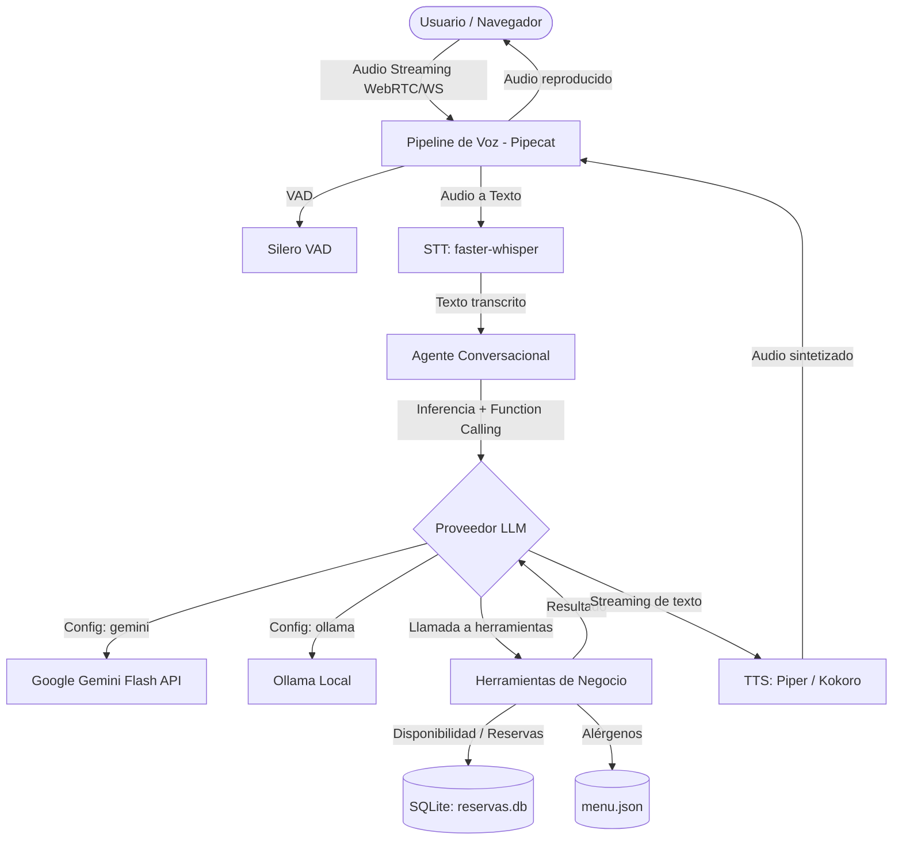

# Agente de Voz con IA para Reservas de Restaurante

> Agente conversacional en tiempo real en español para atención y gestión de reservas en un restaurante ficticio, con soporte para function calling y síntesis/reconocimiento de voz local y en la nube.

---

## Demo

*(Video / GIF demostrativo de interacción por voz en tiempo real)*

---

## Descripción del Proyecto

Este proyecto implementa un agente de voz diseñado para resolver reservas gastronómicas de manera natural y eficiente. El sistema atiende consultas de disponibilidad, creación y cancelación de reservas, y respuesta a dudas sobre alérgenos en el menú mediante herramientas estrictamente tipadas y guardrails conversacionales.

### Características Principales
- **Costo cero:** Diseñado para operar íntegramente con modelos locales y capas gratuitas.
- **Function Calling tipado:** Integración de herramientas de negocio validadas con Pydantic.
- **Arquitectura intercambiable:** Soporte configurable para LLM (Gemini / Ollama), STT (faster-whisper) y TTS (Piper / Kokoro).
- **Voz en tiempo real y barge-in:** Manejo de interrupciones con VAD Silero y streaming mediante Pipecat.
- **Evaluación automatizada:** Suite de pruebas y métricas para medir éxito de tarea, latencia p50/p95 y costo.

---

## Arquitectura



---

## Decisiones Técnicas y Justificación

| Componente | Selección | Justificación |
|---|---|---|
| **Lenguaje y Entorno** | Python 3.12 + `uv` | Rendimiento superior en gestión de paquetes y compatibilidad con el ecosistema de IA. |
| **Backend** | FastAPI + Pydantic | Rendimiento asíncrono, OpenAPI nativo y validación estricta de esquemas de datos. |
| **Persistencia** | SQLite + JSON | Configuración liviana sin dependencias externas ni servidores adicionales para el portafolio. |
| **LLM Primario** | Gemini Flash (`google-genai`) | Baja latencia y capa gratuita generosa para prototipado rápido. |
| **LLM Local** | Ollama (Qwen2.5 7B / Llama 3.1 8B) | Ejecución 100% offline, privacidad y costo cero sin dependencia de internet. |
| **Voz & Orquestación** | Pipecat + Silero + faster-whisper + Piper | Pila abierta, local, modular y optimizada para streaming bidireccional y barge-in. |

---

## Instalación y Ejecución Local

### Prerrequisitos
- Python 3.11 o superior.
- Gestor de paquetes `uv` (o `venv` + `pip`).
- Clave de API de Google Gemini (opcional, para modo nube) u Ollama instalado localmente.

### Pasos

1. **Clonar el repositorio:**
   ```bash
   git clone <repo-url>
   cd "Agente de voz"
   ```

2. **Crear entorno virtual e instalar dependencias:**
   ```bash
   uv venv
   source .venv/bin/activate
   uv pip install -e ".[dev]"
   # O alternativamente:
   # pip install -r requirements.txt
   ```

3. **Configurar variables de entorno:**
   ```bash
   cp .env.example .env
   # Editar .env con tus claves o configuraciones
   ```

4. **Ejecutar tests:**
   ```bash
   pytest
   ```

5. **Iniciar el servidor:**
   ```bash
   uvicorn app.main:app --reload --port 8000
   ```

---

## Métricas y Evaluación

Para reproducir la suite de evaluación automatizada:

```bash
python eval/run_eval.py
```

Resultados generados en `eval/results/summary.md`.

---

## Limitaciones Conocidas

- **Hardware local:** Modelos STT/TTS y LLM locales dependen de la capacidad de CPU/GPU del entorno del usuario.
- **Conexión:** El modo nube depende de la estabilidad de red y latencia hacia los servidores de Google AI Studio.
- **Mono-restaurante:** El MVP está acotado al flujo de un restaurante ficticio sin soporte multi-tenant.

---

## Mejoras Futuras

- Integración con telefonía SIP / WebRTC vía Twilio o LiveKit.
- Soporte para base de datos PostgreSQL / Cloud SQL para entornos productivos concurrentes.
- RAG para responder dudas complejas sobre historia del restaurante o cartas dinámicas.
