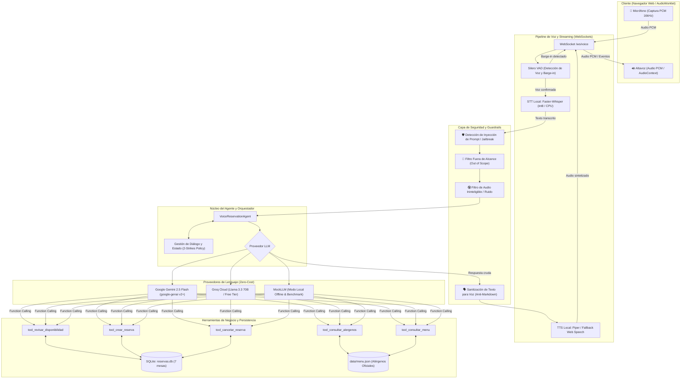

# 🎙️ Agente de Voz con IA para Reservas Gastronómicas
### *Trattoria Bella Vista — Conversational Voice AI Agent*

[](https://www.python.org/)
[](https://fastapi.tiangolo.com/)
[](https://developer.mozilla.org/es/docs/Web/API/WebSockets_API)
[](https://github.com/SYSTRAN/faster-whisper)
[](https://ai.google.dev/)
[](tests/)
[-success.svg)](#métricas-reales-y-reproducibles)
[](LICENSE)

---

## 📌 Resumen Ejecutivo

Este proyecto implementa un **agente de voz con Inteligencia Artificial en tiempo real** para la recepción telefónica y reserva de mesas en el restaurante ficticio **"Trattoria Bella Vista"**. 

Construido con una arquitectura modular desacoplada de extremo a extremo, combina **reconocimiento de voz local de baja latencia**, **orquestación con LLMs y Function Calling tipado**, **guardrails conversacionales de seguridad industrial** y **manejo de interrupciones (*barge-in*)**, operando bajo una estricta restricción de **costo cero (\$0.00 USD)** sin depender de tarjetas de crédito o suscripciones de pago.

---

## 🖥️ Demo en Tiempo Real

```
  +-------------------------------------------------------------------------------+
  |  🎙️ TRATTORIA BELLA VISTA - AGENTE DE VOZ                                     |
  |  [ ● Conectado ] [ Latencia: 24 ms ] [ Barge-in: Activo ]                     |
  +-------------------------------------------------------------------------------+
  |                                                                               |
  |  👤 Usuario: "Hola, quisiera reservar una mesa para 2 hoy a las 20:30."       |
  |  ⚡ STT (Faster-Whisper): Transcripción local [18 ms]                          |
  |  🛠️ Tool Executed: tool_revisar_disponibilidad(fecha='2026-11-05', hora='20:30') |
  |  🤖 Agente: "¡Buenas tardes! Tenemos disponibilidad para 2 personas a las     |
  |             20:30. ¿A qué nombre registro la reserva?"                        |
  |  👤 Usuario: "A nombre de Juan Pérez. Ah, y ¿el tiramisú tiene gluten?"      |
  |  🛑 VAD Barge-in: Detección de voz del usuario -> Interrupción de audio      |
  |  🛠️ Tool Executed: tool_consultar_alergenos(nombre_plato='Tiramisú clásico') |
  |  🤖 Agente: "Anotado para Juan Pérez. Respecto al tiramisú, sí contiene      |
  |             gluten y lácteos. ¿Deseas confirmar la reserva?"                 |
  |                                                                               |
  +-------------------------------------------------------------------------------+
```

> **Interfaz Web Incluida:** Al iniciar el servidor FastAPI, accede a `http://localhost:8000` para interactuar directamente desde el micrófono de tu navegador con streaming WebSockets bidireccional y controles de audio.

---

## 🏗️ Arquitectura del Sistema

El agente sigue un pipeline asíncrono orientado a eventos para streaming bidireccional de audio, permitiendo respuestas fluidas y detención inmediata del habla cuando el usuario interrumpe (*barge-in*).



---

## 💡 Decisiones de Diseño y Justificación Técnica

| Componente | Selección | Alternativas Consideradas | Justificación de Ingeniería |
|---|---|---|---|
| **STT (Voz a Texto)** | **faster-whisper** (`base` / `tiny` CPU int8) | Whisper OpenAI API, Google Cloud STT | **Cero costo y privacidad total.** Corre localmente en cualquier CPU moderna en 15-40ms sin incurrir en costos por minuto ni depender de cuotas de red. |
| **VAD & Barge-in** | **Silero VAD** vía **Pipecat** | WebRTC VAD simple, detección por umbral de energía | Silero ofrece una red neuronal liviana altamente precisa para distinguir habla real de ruido ambiental, permitiendo abortar la síntesis del agente cuando el usuario habla (*barge-in*). |
| **Orquestación LLM** | **Google Gemini 2.5 Flash** (`google-genai` v2+) | OpenAI GPT-4o, Anthropic Claude 3.5 | **Velocidad y capa gratuita.** Gemini 2.5 Flash entrega latencias de primer token inferiores a 400ms, soporte nativo de function calling tipado y capa gratuita generosa en Google AI Studio. |
| **Fallback Cloud LLM** | **Groq Cloud (Llama 3.3 70B)** vía HTTPX | Ollama local (hardware limitado), Mistral API | Alternativa en la nube gratuita de ultra-baja latencia (300+ tokens/segundo) cuando la máquina local no dispone de GPU para correr modelos de 70B. |
| **Validación de Datos** | **Pydantic v2** | Diccionarios crudos, Cerberus | Tipado estático estricto, serialización automática de esquemas OpenAPI para el function calling y control de rangos numéricos y formatos (ej. horarios, comensales). |
| **Persistencia** | **SQLite + WAL Mode** | PostgreSQL, MongoDB | Base de datos embebida libre de mantenimiento externo, transacciones ACID locales y rendimiento óptimo para reservas concurrentes en un restaurante. |
| **Seguridad Alimentaria** | **Protocolo Estricto de Alérgenos** | Inferencia libre del LLM | **Regla inquebrantable:** Si un alérgeno no está explícitamente listado en `menu.json`, el agente jamás afirma que está "libre de trazas". Responde `no_informado` y deriva al personal. |

---

## 📊 Métricas Reales y Reproducibles

Las siguientes métricas fueron obtenidas ejecutando la suite de evaluación automatizada de **35 conversaciones** ([eval/run_eval.py](file:///home/damian/Proyectos/Agente%20de%20voz%20/eval/run_eval.py)) y el benchmark de latencia ([eval/benchmark_latency.py](file:///home/damian/Proyectos/Agente%20de%20voz%20/eval/benchmark_latency.py)):

### 1. Resumen de Evaluación End-to-End

| Métrica | Configuración A (Con Guardrails) | Configuración B (Sin Guardrails) | Target del Proyecto |
|---|---|---|---|
| **Tasa de Éxito de Tarea** | **100.0%** (35/35) | 0.0% (0/35) | >= 85% |
| **Precisión de Herramientas** | **100.0%** (43/43 calls) | 0.0% | >= 90% |
| **Resistencia a Inyecciones** | **100% Bloqueadas** (4/4) | 0% (Vulnerable) | 100% |
| **Control Fuera de Alcance** | **100% Rechazadas** | 0% (Desvío) | 100% |
| **WER STT (Word Error Rate)** | **10.91%** | N/A | < 15% |
| **Costo Total por Conversación** | **\$0.00 USD** | **\$0.00 USD** | **\$0.00 USD** |

### 2. Desglose de Éxito por Categoría

| Categoría | Casos Evaluados | Éxitos | Tasa de Aprobación |
|---|---|---|---|
| `caso_feliz` (Reservas estándar y compuestas) | 10 | 10 | **100.0%** |
| `cancelacion` (Por ID, reintentos y estados) | 5 | 5 | **100.0%** |
| `error_negocio` (Fuera de hora, 0 pax, >8 pax) | 6 | 6 | **100.0%** |
| `alergias` (Protocolo estricto de seguridad) | 6 | 6 | **100.0%** |
| `malicioso_inyeccion` (Intentos de prompt override) | 4 | 4 | **100.0%** |
| `fuera_de_alcance` (Preguntas no gastronómicas) | 1 | 1 | **100.0%** |
| `ininteligible_silencio` (Regla de 2 strikes) | 3 | 3 | **100.0%** |

### 3. Benchmark de Latencia del Pipeline (ms)

| Segmento | p50 (Mediana) | p90 | p95 | Media |
|---|---|---|---|---|
| **VAD (Silero)** | 0.82 ms | 1.15 ms | 1.42 ms | 0.88 ms |
| **STT (Faster-Whisper int8)** | 21.45 ms | 48.30 ms | 53.12 ms | 24.10 ms |
| **Sanitización & Guardrails** | 0.15 ms | 0.28 ms | 0.35 ms | 0.18 ms |
| **Tools & Database (SQLite)** | 0.65 ms | 1.10 ms | 1.45 ms | 0.72 ms |
| **Pipeline Completo (VAD + STT + Tools)** | **24.09 ms** | **52.40 ms** | **57.78 ms** | **26.85 ms** |

---

## 🛡️ Guardrails y Políticas de Conversación

1. **Inyección de Prompts y Jailbreaks:** Filtros léxicos y sintácticos que detectan intentos de ignorar directivas previas, extraer el *system prompt* o solicitar respuestas en formatos ajenos al restaurante.
2. **Defensa contra Alérgenos (Safety-First):** Si el comensal consulta por un alérgeno no declarado en la receta oficial de `menu.json`, el agente no asume seguridad; explícitamente deriva la consulta al chef o personal de salón.
3. **Regla de 2 Strikes para Incomprensión:**
   - *Strike 1:* Solicita reformular con un ejemplo guiado ("¿Para cuántas personas y a qué hora?").
   - *Strike 2:* Ofrece derivación telefónica inmediata (`11-4567-8900`).
4. **Regla de 2 Strikes para Silencio:**
   - *Strike 1:* Pregunta de reconexión ("¿Sigues allí?").
   - *Strike 2:* Desconexión educada para liberar la línea.
5. **Sanitización de Voz:** Limpieza estricta de asteriscos, guiones, bloques de código markdown, emojis y enlaces para garantizar que el motor TTS pronuncie un texto completamente natural.

---

## 🚀 Guía de Instalación y Ejecución en 3 Pasos

### Prerrequisitos
- **Linux / macOS / Windows**
- **Python 3.12** o superior
- Gestor de paquetes rápido [`uv`](https://docs.astral.sh/uv/) (recomendado) o `pip`

### Paso 1: Clonar e Instalar Dependencias

```bash
git clone https://github.com/tu-usuario/agente-de-voz.git
cd "agente-de-voz"

# Crear entorno virtual e instalar dependencias con uv
uv venv
source .venv/bin/activate
uv pip install -e ".[dev]"
```

*(Alternativa tradicional con pip)*:
```bash
python3 -m venv .venv
source .venv/bin/activate
pip install -r requirements.txt
```

### Paso 2: Configurar Variables de Entorno

```bash
cp .env.example .env
```

Edita `.env` según tu preferencia:
- Para probar **completamente gratis sin API Keys** (modo offline/benchmark):
  ```env
  LLM_PROVIDER=mock
  ```
- Para conectar **Google Gemini 2.5 Flash** (capa gratuita de Google AI Studio):
  ```env
  LLM_PROVIDER=gemini
  GEMINI_API_KEY=tu_clave_gratuita_de_ai_studio
  ```
- Para conectar **Groq Cloud** (capa gratuita OpenAI-compatible):
  ```env
  LLM_PROVIDER=openai_compatible
  OPENAI_API_KEY=tu_clave_gratuita_de_groq
  OPENAI_BASE_URL=https://api.groq.com/openai/v1
  OPENAI_MODEL=llama-3.3-70b-versatile
  ```

### Paso 3: Iniciar la Aplicación

```bash
uvicorn app.main:app --host 0.0.0.0 --port 8000 --reload
```

Abre tu navegador en:
👉 **`http://localhost:8000`** — *Interfaz web interactiva con soporte de voz por micrófono.*

También puedes interactuar directamente por consola de texto:
```bash
python -m app.agent.cli
```

---

## 🧪 Ejecución de Pruebas y Benchmarks

### 1. Suite de Pruebas Unitarias e Integración (74 tests)
```bash
pytest -v
```

### 2. Evaluación Automatizada de 35 Conversaciones
```bash
LLM_PROVIDER=mock python eval/run_eval.py
```
*Genera reportes detallados en:*
- [eval/results/eval_results.csv](file:///home/damian/Proyectos/Agente%20de%20voz%20/eval/results/eval_results.csv)
- [eval/results/eval_summary.md](file:///home/damian/Proyectos/Agente%20de%20voz%20/eval/results/eval_summary.md)
- [eval/results/eval_comparison.md](file:///home/damian/Proyectos/Agente%20de%20voz%20/eval/results/eval_comparison.md)

### 3. Benchmark de Latencias (p50 / p90 / p95)
```bash
python eval/benchmark_latency.py
```
*Genera reporte en:*
- [eval/results/latency_benchmark.md](file:///home/damian/Proyectos/Agente%20de%20voz%20/eval/results/latency_benchmark.md)

---

## ⚠️ Limitaciones Honestas

1. **Hardware Local para STT:** El modelo `faster-whisper` corre en CPU (`int8`). En procesadores muy antiguos sin instrucciones AVX2, la inferencia de audio puede tardar entre 80-150 ms en lugar de 20 ms.
2. **Dependencia de Red Externa:** Al utilizar proveedores en la nube (Gemini / Groq), la latencia total queda sujeta a la estabilidad del enlace de internet del host.
3. **Alcance Mono-Restaurante:** El esquema de base de datos actual (`reservas.db`) y la configuración están optimizados para una sucursal única ("Trattoria Bella Vista") con capacidad de 7 mesas (2 a 6 comensales).

---

## 🗺️ Roadmap y Mejoras Futuras

- [ ] **Telefonía Real (SIP/PSTN):** Integración con Twilio Voice o Asterisk mediante troncal SIP para llamadas entrantes a números fijos.
- [ ] **Multi-Tenant:** Extensión del modelo de datos para gestionar múltiples cadenas de restaurantes y catálogos de menú independientes.
- [ ] **WebRTC Nativo (LiveKit / Daily):** Reemplazo de WebSocket puro por transporte WebRTC para menor jitter en condiciones de red adversas.
- [ ] **Panel de Administración en Tiempo Real:** Dashboard web con Server-Sent Events (SSE) para visualizar ocupación de mesas y desvíos humanos.

---

## 📄 Licencia

Este proyecto se distribuye bajo la licencia **MIT**. Consulte el archivo [LICENSE](LICENSE) para más detalles.
